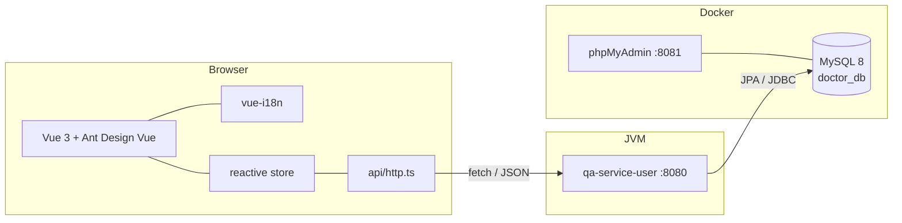
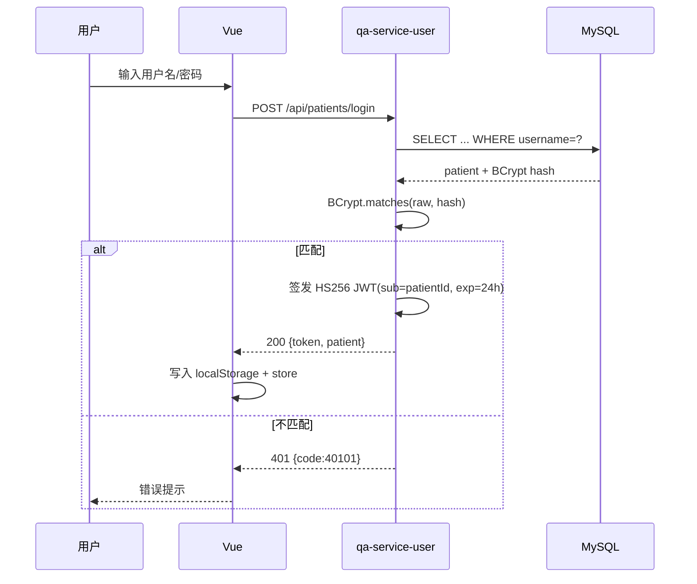

# 设计文档

## 1. 概述

本文档描述本次面试任务三个需求的整体设计：

1. Web 首页中英文切换（`web/qa-web/src/locales`）；
2. 医生数据由前端 JSON 迁移到 MySQL，并在 `qa-service-user` 提供医生列表 API；
3. 问诊用户用户名密码登录（含注册、JWT 会话、前端登录页）。

需求 3 的详细产品定义见 `docs/PRD-patient-login.md`，接口测试流程见 `docs/API_TEST.md`。

---

## 2. 系统架构



| 组件 | 技术 | 职责 |
| --- | --- | --- |
| `web/qa-web` | Vue 3 + TypeScript + Vite + Ant Design Vue + vue-i18n | 页面渲染、国际化、调用后端 |
| `server/qa-service-user` | Spring Boot 3.5 / Java 17 / Spring Data JPA | 医生与患者账号 API |
| MySQL 8 | Docker | 持久化医生、患者数据 |
| phpMyAdmin | Docker | 数据库可视化管理 |

---

## 3. 需求 1：首页国际化

### 3.1 资源组织

```
web/qa-web/src/locales/
├── index.ts      # createI18n、locale 检测与持久化 key、下拉选项
├── zh-CN.ts      # 中文资源
└── en-US.ts      # 英文资源
```

资源按 `nav / language / home / footer` 分组，键名与页面结构对应，避免扁平键名冲突。

### 3.2 语言检测与持久化

1. 优先读取 `localStorage['qa-locale']`；
2. 其次根据 `navigator.language`（`zh*` → 中文，其余 → 英文）；
3. 用户切换时写入 localStorage，并同步 `document.documentElement.lang`；
4. `fallbackLocale` 设为 `zh-CN`，缺失键时中文兜底。

### 3.3 切换入口

`AppHeader.vue` 右上角（登录按钮左侧）渲染 `a-select`，仅在首页（`route.path === '/'`）显示，符合“只处理首页”的范围约束。导航与页脚属于首页可见的公共框架，一并接入 i18n；其他页面正文不在范围内。

### 3.4 覆盖范围

- 首页 Hero、特性列表、操作按钮、统计卡片、开放诊室、加载/错误/空状态、图片 alt；
- 顶部导航、页脚；
- 医生姓名/科室等业务数据保持数据库原文（数据库中为中文），不做机器翻译，避免语义错误。

---

## 4. 需求 2：医生数据入库与列表 API

### 4.1 数据库设计

`doctor` 表以业务 ID `doc001...` 为主键，与前端既有 `doctor.id` 及问诊记录中的 `doctorId` 保持一致；`specialties` 使用 MySQL `JSON` 列，JPA 通过 `StringListConverter` 与 `List<String>` 互转；`is_active` 表示是否在线接诊。

```sql
doctor(
  id VARCHAR(20) PK,
  username VARCHAR(50) UNIQUE,
  password VARCHAR(100),      -- BCrypt
  name, title, department, avatar, experience,
  specialties JSON,
  is_active TINYINT(1),
  created_at DATETIME
)
```

DDL 与种子数据位于 `docker/mysql/init/`，MySQL 容器首次启动时按文件名顺序执行。

### 4.2 API 设计

统一响应：

```json
{ "code": 0, "message": "success", "data": ... }
```

| 方法 | 路径 | 说明 |
| --- | --- | --- |
| GET | `/api/doctors` | 医生列表；`?activeOnly=true` 仅在线医生 |
| GET | `/api/doctors/{id}` | 医生详情 |
| POST | `/api/doctors/login` | 医生用户名密码登录（BCrypt 校验） |

返回 DTO 不含 `password`。前端 `Doctors.vue` 展示列表，`Home.vue` 的“开放诊室”和“专业医生/在线诊室”统计也复用同一数据源，避免首页与医生页数据不一致。

### 4.3 前后端联调

- 前端 `src/api/http.ts` 统一拼接 `VITE_API_BASE_URL`（默认 `http://localhost:8080`），解析统一响应并把业务错误转成 `ApiError`；
- `store.loadDoctors()` 在应用挂载时加载一次，医生页在数据为空时兜底加载；
- 加载中展示 `a-spin`，失败展示错误 + 重试，空数据展示 `a-empty`；
- CORS 由 `CorsConfig` 放开本地开发源，`OPTIONS` 预检可用。

### 4.4 种子数据

5 位医生（4 位在线 / 1 位离线），密码统一 `123456` 的 BCrypt 哈希；与迁移前的 `doctor-user-list.json` 字段、顺序一致。

---

## 5. 需求 3：问诊用户登录

### 5.1 认证流程



### 5.2 密码与令牌

- 密码：`BCryptPasswordEncoder`（cost 10），数据库只存哈希；
- 令牌：JJWT 0.12.6，HS256，`sub = patientId`，默认 24 小时；
- 密钥：`app.jwt.secret`，默认值仅用于本地；生产必须通过 `JWT_SECRET` 覆盖（≥ 32 字节，启动时校验）；
- 校验：`GET /api/patients/me` 手动解析 `Authorization: Bearer <token>`，无需引入完整 Spring Security 过滤器链，降低本次需求复杂度；
- 失效：签名错误、格式错误、过期、账号删除均返回 401，前端清除本地会话。

### 5.3 前端状态

`store` 负责：

- `patientToken` / `currentPatient` 响应式状态；
- `loginPatient` / `registerPatient` 成功后同时写 localStorage；
- `restorePatientSession()` 在 `App.vue` 挂载时调用 `/me` 校验，失败静默清理；
- `logoutPatient()` 清除内存与 localStorage。

### 5.4 页面

`Consultation.vue` 未登录时展示“登录 / 注册”两个 Tab；注册成功即自动登录进入门户。已登录门户、问题提交、医生端诊室逻辑保持原样，仅将患者 ID 类型对齐为字符串。

---

## 6. 错误模型

| HTTP | code | 含义 | 产生位置 |
| --- | --- | --- | --- |
| 200/201 | 0 | 成功 | 正常返回 |
| 400 | 40001 | 参数校验失败 / 请求体不可读 | `GlobalExceptionHandler` |
| 401 | 40101 | 未认证、凭证错误、token 失效 | 业务异常 |
| 404 | 40401 | 资源不存在 | 业务异常 |
| 409 | 40901 | 唯一性冲突 / 数据完整性 | 业务异常 / DataIntegrityViolation |
| 500 | 50001 | 未预期异常（记录 ERROR 日志） | 兜底处理 |

---

## 7. 配置与环境

| 配置 | 位置 | 说明 |
| --- | --- | --- |
| MySQL 端口 | `docker-compose.yml` | `3306`；phpMyAdmin `8081` |
| 应用数据库账号 | `docker-compose.yml` / `application.properties` | `qa_user / Qa@123456` |
| 后端端口 | `application.properties` | `8080`，可用 `SERVER_PORT` 覆盖 |
| 前端 API 地址 | `VITE_API_BASE_URL` | 默认 `http://localhost:8080` |
| JWT 密钥 | `JWT_SECRET` | 生产必改 |
| 测试库 | `src/test/resources/application.properties` | H2 内存库，`mvn test` 不依赖 Docker |

---

## 8. 关键设计决策

| 决策 | 备选方案 | 选择理由 |
| --- | --- | --- |
| 医生主键使用业务 ID `doc001` | 自增 BIGINT | 与既有前端数据、问诊记录 `doctorId` 完全兼容，迁移零改数据 |
| `specialties` 存 JSON 列 | 关联子表 | 读多写少、无按擅长领域检索需求，JSON 更简单；通过 Converter 保持类型安全 |
| JWT 手动校验 | 引入 Spring Security | 需求只有三个接口，避免过滤器链/角色体系的额外复杂度；生产可平滑替换 |
| 注册即登录 | 注册后跳转登录 | 减少一次输入，提升转化；PRD 已定义 |
| 患者会话存 localStorage | sessionStorage / Cookie | 刷新与重开页面均可恢复；JWT 无状态，XSS 风险通过不渲染用户 HTML 控制（生产建议 HttpOnly Cookie） |
| H2 测试库 | 测试依赖 Docker MySQL | `mvn test` 可在任何环境运行，CI 友好 |
| 首页统计复用医生 API | 保留前端 JSON | 医生数据唯一来源，避免首页与医生页不一致 |

---

## 9. 文件变更清单

### 后端

| 文件 | 说明 |
| --- | --- |
| `pom.xml` | JPA、Validation、MySQL、BCrypt、JJWT、H2 |
| `application.properties` | 数据源、JWT、CORS、Actuator |
| `common/ApiResponse.java` | 统一响应 |
| `common/BusinessException.java` / `GlobalExceptionHandler.java` | 业务异常与全局处理 |
| `config/PasswordConfig.java` | BCrypt Bean |
| `entity/Doctor.java` / `Patient.java` | JPA 实体 |
| `converter/StringListConverter.java` | JSON ↔ List |
| `repository/*` | 数据访问 |
| `dto/*` | 请求/响应模型（record） |
| `service/DoctorService.java` / `PatientService.java` / `JwtService.java` | 业务逻辑 |
| `controller/DoctorController.java` / `PatientAuthController.java` | REST API |
| `src/test/.../JwtServiceTest.java` + `src/test/resources/application.properties` | 单测与 H2 配置 |

### 前端

| 文件 | 说明 |
| --- | --- |
| `src/locales/index.ts` / `zh-CN.ts` / `en-US.ts` | i18n 初始化与资源 |
| `src/components/AppHeader.vue` | 右上角语言切换、导航文案 |
| `src/components/AppFooter.vue` | 页脚文案 |
| `src/views/Home.vue` | 首页文案国际化、医生加载态 |
| `src/views/Doctors.vue` | 医生列表改为 API 数据 + 加载/错误/空状态 |
| `src/views/DoctorLogin.vue` | 医生登录改走 API |
| `src/views/Consultation.vue` | 患者登录/注册 Tabs、会话恢复 |
| `src/api/http.ts` / `doctor.ts` / `patient.ts` | API 封装 |
| `src/store/index.ts` | 医生加载、患者会话持久化 |
| `src/App.vue` / `src/main.ts` / `src/vite-env.d.ts` | 启动加载、i18n 注册、环境变量类型 |

### 数据库与运维

| 文件 | 说明 |
| --- | --- |
| `docker-compose.yml` | MySQL + phpMyAdmin，挂载初始化脚本 |
| `docker/mysql/init/01-schema.sql` | 建库建表、应用账号授权 |
| `docker/mysql/init/02-seed.sql` | 医生与患者种子数据 |

### 文档与测试

`docs/PRD_TEMPLATE.md`、`docs/PRD-patient-login.md`、`docs/DESIGN.md`、`docs/API_TEST.md`、`docs/TEST_REPORT.md`、`docs/prompts.md`、`tests/api-test.sh`。

---

## 10. 后续演进建议

1. 接入 Spring Security + 刷新令牌，把 token 放入 HttpOnly Cookie；
2. 登录失败次数限制、图形验证码、审计日志；
3. 医生/患者数据做逻辑删除与操作审计；
4. 前端路由拆包（当前单包 1.6MB）与按需加载 Ant Design 组件；
5. 为医生列表增加分页、科室筛选与缓存。
