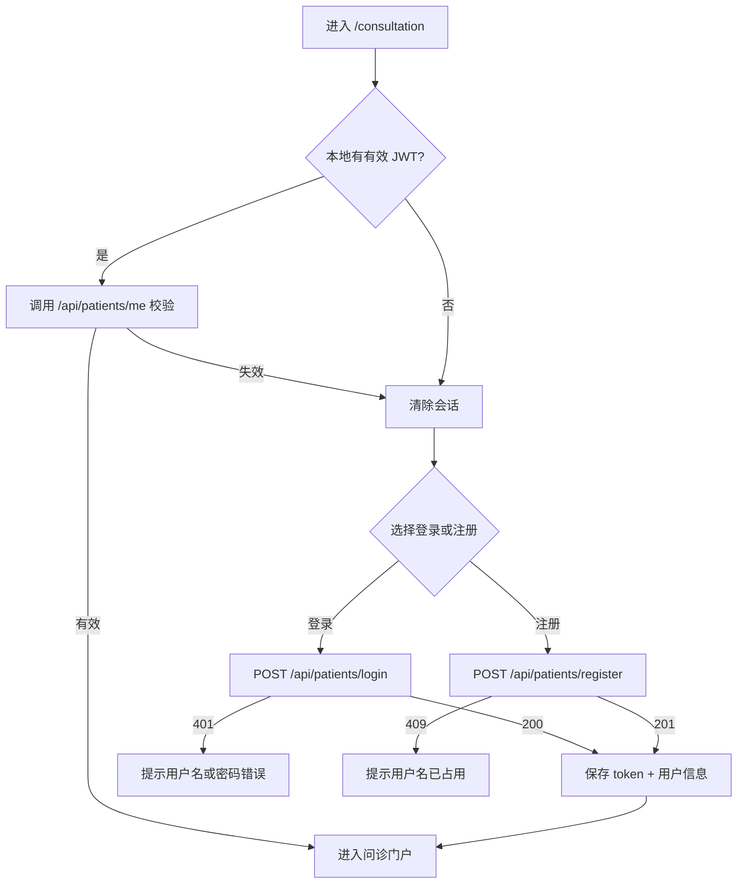

# PRD：问诊用户用户名密码登录

## 1. 文档信息

| 字段 | 内容 |
| --- | --- |
| 文档名称 | 问诊用户用户名密码登录 PRD |
| 文档版本 | v1.0 |
| 文档状态 | 已确认 / 已实现 |
| 作者 | AI 协作（基于 `docs/PRD_TEMPLATE.md`） |
| 创建日期 | 2026-10-29 |
| 最后更新 | 2026-10-29 |
| 关联需求 | 《项目要求.md》技术要求第 3 条 |
| 关联文档 | `docs/DESIGN.md`、`docs/API_TEST.md`、`docs/TEST_REPORT.md` |

### 1.1 变更记录

| 版本 | 日期 | 变更人 | 变更说明 |
| --- | --- | --- | --- |
| v1.0 | 2026-10-29 | AI 协作 | 初稿并据以完成开发 |

---

## 2. 背景与目标

### 2.1 背景

当前问诊页面（`web/qa-web/src/views/Consultation.vue`）通过“姓名 + 生日”做身份校验：

- 任意输入都会被视为有效身份，首次输入还会在浏览器内存中自动创建患者，无法区分真实用户；
- 患者数据只存在于前端内存，刷新即丢失，无法支撑后续问诊记录、处方、订单等能力；
- 没有凭证校验，任何人只要知道姓名和生日即可冒用他人身份。

系统已经具备 MySQL（`docker-compose.yml`）和 `qa-service-user` Spring Boot 服务，因此可以将患者账号落到数据库中，并提供用户名密码登录。

### 2.2 目标

1. 问诊用户可以使用**用户名 + 密码**注册并登录；
2. 登录成功后获得有时效的会话凭证（JWT），刷新页面后可恢复登录状态；
3. 密码以 BCrypt 哈希存储，任何接口都不返回密码或哈希；
4. 登录状态失效时前端自动回到登录页，不出现“假登录”。

### 2.3 成功指标

| 指标 | 现状 | 目标值 | 统计方式 |
| --- | --- | --- | --- |
| 登录接口成功率（正确凭证） | 无 | 100% | 接口测试 |
| 错误凭证被拒绝 | 无 | 100% | 接口测试 |
| 密码泄露 | 姓名+生日可冒用 | 0 处返回明文/哈希 | 接口响应检查 + 代码审查 |

---

## 3. 用户与使用场景

### 3.1 目标用户

| 用户角色 | 特征 | 核心诉求 |
| --- | --- | --- |
| 问诊用户（患者） | 首次或再次使用在线问诊 | 用固定账号登录，查看自己的问诊记录 |
| 已注册但会话过期的用户 | 隔天再次访问 | 输入账号密码快速恢复会话 |
| 新用户 | 首次访问 | 注册后直接进入问诊 |

### 3.2 核心场景

1. 作为新用户，我希望注册账号后直接登录，以便立即发起问诊。
2. 作为老用户，我希望用用户名和密码登录，以便查看历史问诊。
3. 作为已登录用户，我希望刷新页面后仍保持登录，以免重复输入。
4. 作为用户，我希望输错密码时得到明确提示，而不是被静默放行。

### 3.3 用户流程



---

## 4. 范围

### 4.1 本次范围（In Scope）

- 患者账号注册（用户名、密码、姓名，生日/手机号/性别选填）；
- 患者用户名密码登录；
- JWT 会话签发与 `GET /api/patients/me` 校验；
- 前端登录/注册 UI、加载态、错误提示、退出登录；
- 登录状态持久化（localStorage）与过期自动清理；
- 患者数据 MySQL 表结构、种子账号；
- 上述接口的 curl 自动化测试与文档。

### 4.2 不在本次范围（Out of Scope）

- 短信验证码、邮箱验证、找回密码、修改密码；
- 第三方登录（微信、OAuth）；
- 图形验证码、登录失败锁定、风控；
- 管理员后台、角色权限体系；
- 医生端登录改造（医生登录已在需求 2 中通过 `/api/doctors/login` 提供）；
- 刷新令牌（refresh token）与主动登出服务端撤销列表。

### 4.3 假设与约束

- 前端为 Vue 3 + TypeScript + Vite，后端为 Spring Boot 3 + JPA + MySQL 8；
- 演示环境通过 `docker-compose.yml` 启动 MySQL；
- 时间约束为 1 天内完成，因此采用单体、无 Spring Security 过滤器链的轻量实现；
- 视频/演示环境仅面向本地开发，HTTP 明文传输可接受；生产必须启用 HTTPS。

---

## 5. 术语表

| 术语 | 定义 |
| --- | --- |
| 问诊用户 / 患者 | 在平台发起咨询的用户，对应 `patient` 表 |
| JWT | JSON Web Token，登录成功后签发的无状态会话凭证 |
| BCrypt | 带盐的慢哈希算法，用于存储密码 |
| Bearer Token | HTTP `Authorization: Bearer <token>` 形式的凭证传递方式 |

---

## 6. 功能需求

### FR-01 用户注册（P0）

- **描述**：未登录用户可在问诊页“注册”页签创建账号，注册成功后自动登录。
- **业务规则**：
  - 用户名必填，3–32 位，仅允许字母、数字、下划线，全局唯一；
  - 密码必填，6–64 位；
  - 姓名必填，最长 50 字符；
  - 生日选填，必须是过去的日期；
  - 手机号选填，最长 20 字符；性别选填，取值 男/女/其他；
  - 两次密码必须一致（前端校验）；
  - 密码使用 BCrypt（cost=10）哈希后入库。
- **验收标准**：
  - **Given** 用户名 `autotest_123` 未被占用
  - **When** 提交合法注册信息
  - **Then** 返回 HTTP 201、`code=0`、JWT 与患者信息（不含密码），前端直接进入门户
  - **Given** 用户名已存在
  - **When** 再次提交相同用户名
  - **Then** 返回 HTTP 409、`code=40901`
  - **Given** 密码只有 3 位
  - **When** 提交注册
  - **Then** 返回 HTTP 400、`code=40001`

### FR-02 用户登录（P0）

- **描述**：已注册用户使用用户名和密码登录。
- **业务规则**：
  - 用户名或密码错误统一返回“用户名或密码错误”，不泄露账号是否存在；
  - 登录成功返回 JWT（HS256，默认 24 小时有效）与患者基本信息。
- **验收标准**：
  - **Given** 存在账号 `zhaoming / Patient@123`
  - **When** 提交正确凭证
  - **Then** HTTP 200、`code=0`、`data.token` 非空、`data.patient.username=zhaoming`
  - **When** 提交错误密码
  - **Then** HTTP 401、`code=40101`
  - **When** 提交不存在的用户名
  - **Then** HTTP 401、`code=40101`

### FR-03 会话校验（P0）

- **描述**：前端启动时使用已保存的 JWT 调用 `GET /api/patients/me` 校验会话。
- **业务规则**：
  - 必须携带 `Authorization: Bearer <token>`；
  - token 缺失、格式错误、签名不匹配或过期均返回 401；
  - token 有效但账号已删除，同样返回 401。
- **验收标准**：
  - **Given** 有效 token
  - **When** 请求 `/api/patients/me`
  - **Then** HTTP 200，返回当前患者信息
  - **Given** 无 token / 伪造 token / 过期 token
  - **When** 请求 `/api/patients/me`
  - **Then** HTTP 401、`code=40101`

### FR-04 退出登录（P1）

- **描述**：用户点击“退出登录”后清除本地 token 与患者信息，回到未登录状态。
- **验收标准**：
  - **Given** 已登录
  - **When** 点击退出
  - **Then** 页面展示登录表单，刷新后仍为未登录状态

### FR-05 登录状态恢复（P1）

- **描述**：刷新页面后，前端从 localStorage 读取 token 并调用 `/me`；失败则自动清理，避免展示过期身份。
- **验收标准**：
  - **Given** 上次登录成功且 token 未过期
  - **When** 刷新页面
  - **Then** 直接进入问诊门户
  - **Given** token 已过期或后端数据被清理
  - **When** 刷新页面
  - **Then** 回到登录表单，无报错弹窗轰炸

### FR-06 前端表单体验（P2）

- 登录/注册使用 Tabs 切换；
- 提交按钮展示 loading，防止重复提交；
- 接口错误以 `message.error` 展示后端返回的中文文案；
- 注册页展示测试账号提示，便于验收。

---

## 7. 非功能需求

| 编号 | 类别 | 要求 | 验收方式 |
| --- | --- | --- | --- |
| NFR-01 | 安全 | 密码只以 BCrypt 哈希入库，任何响应不包含 `password` 字段 | 接口测试 + 代码审查 |
| NFR-02 | 安全 | JWT 使用 HS256，密钥至少 32 字节，可通过环境变量 `JWT_SECRET` 覆盖 | 配置审查 |
| NFR-03 | 安全 | 登录失败不区分“用户不存在”和“密码错误” | 接口测试 |
| NFR-04 | 一致性 | 所有接口统一 `{code,message,data}` 响应结构 | 接口测试 |
| NFR-05 | 校验 | 后端参数校验与前端校验保持一致，且后端为准 | 接口测试 |
| NFR-06 | 可观测性 | `/actuator/health` 可用；未处理异常记录 ERROR 日志 | 手工检查 |
| NFR-07 | 兼容性 | 支持 Chrome/Edge 最新两个大版本；移动端 375px 宽度可用 | 手工验收 |

---

## 8. 交互与界面说明

### 8.1 页面/组件清单

| 页面/组件 | 路径 | 说明 |
| --- | --- | --- |
| 问诊页 | `web/qa-web/src/views/Consultation.vue` | 未登录展示登录/注册 Tabs；已登录展示门户 |
| 前端 API 层 | `web/qa-web/src/api/patient.ts` | 登录、注册、`/me` 请求封装 |
| 全局状态 | `web/qa-web/src/store/index.ts` | 保存 token/currentPatient，负责持久化与恢复 |

### 8.2 交互细节

- 登录表单：用户名、密码均为必填；提交时按钮 loading。
- 注册表单：用户名、密码、确认密码、姓名必填；生日/手机号/性别选填；两次密码不一致时阻止提交。
- 错误态：网络不可达时提示“无法连接后端服务，请确认 qa-service-user 已启动”。
- 成功反馈：登录成功 toast “欢迎回来，<姓名>”；注册成功 toast “注册成功，欢迎，<姓名>”。
- 会话恢复：应用挂载时静默调用 `/me`，不在失败时弹窗。

### 8.3 文案

| 场景 | 中文文案 |
| --- | --- |
| 用户名必填 | 请输入用户名 |
| 密码必填 | 请输入密码 |
| 密码长度 | 密码长度需在 6-64 个字符之间 |
| 密码不一致 | 两次输入的密码不一致 |
| 凭证错误 | 用户名或密码错误 |
| 用户名冲突 | 用户名已被占用: xxx |
| 网络错误 | 无法连接后端服务，请确认 qa-service-user 已启动 |

---

## 9. 数据与接口契约

### 9.1 数据模型

表：`patient`

| 字段 | 类型 | 约束 | 说明 |
| --- | --- | --- | --- |
| id | BIGINT | PK, AUTO_INCREMENT | 主键 |
| username | VARCHAR(50) | NOT NULL, UNIQUE | 登录用户名 |
| password | VARCHAR(100) | NOT NULL | BCrypt 哈希 |
| name | VARCHAR(50) | NOT NULL | 姓名 |
| birthday | DATE | NULL | 生日 |
| phone | VARCHAR(20) | NULL | 手机号 |
| gender | VARCHAR(10) | NULL | 性别 |
| created_at | DATETIME | NOT NULL, DEFAULT CURRENT_TIMESTAMP | 创建时间 |

建表脚本：`docker/mysql/init/01-schema.sql`；种子数据：`docker/mysql/init/02-seed.sql`。

### 9.2 接口列表

| 编号 | 方法 | 路径 | 鉴权 | 说明 |
| --- | --- | --- | --- | --- |
| API-01 | POST | `/api/patients/register` | 无 | 注册并自动登录 |
| API-02 | POST | `/api/patients/login` | 无 | 用户名密码登录 |
| API-03 | GET | `/api/patients/me` | Bearer JWT | 获取当前患者 |

### 9.3 接口详情

#### API-01 注册

```http
POST /api/patients/register
Content-Type: application/json

{
  "username": "autotest_001",
  "password": "Patient@123",
  "name": "Auto Test",
  "birthday": "1992-05-20",
  "phone": "13800009999",
  "gender": "男"
}
```

成功：HTTP 201

```json
{
  "code": 0,
  "message": "注册成功",
  "data": {
    "token": "<jwt>",
    "patient": {
      "id": 3,
      "username": "autotest_001",
      "name": "Auto Test",
      "birthday": "1992-05-20",
      "phone": "13800009999",
      "gender": "男"
    }
  }
}
```

失败：

| HTTP | code | 场景 |
| --- | --- | --- |
| 400 | 40001 | 参数校验失败 |
| 409 | 40901 | 用户名已存在 |

#### API-02 登录

```http
POST /api/patients/login
Content-Type: application/json

{ "username": "zhaoming", "password": "Patient@123" }
```

成功：HTTP 200，结构同 API-01。失败：HTTP 401 / `code=40101`（用户名或密码错误）。

#### API-03 当前患者

```http
GET /api/patients/me
Authorization: Bearer <jwt>
```

成功：HTTP 200

```json
{
  "code": 0,
  "message": "success",
  "data": {
    "id": 1,
    "username": "zhaoming",
    "name": "赵明",
    "birthday": "1985-03-15",
    "phone": "13800001234",
    "gender": "男"
  }
}
```

失败：HTTP 401 / `code=40101`（缺少、伪造或过期 token）。

---

## 10. 拆分步骤（Implementation Plan）

| 步骤 | 内容 | 交付物 | 验证方式 | 依赖 |
| --- | --- | --- | --- | --- |
| SP-1 | 数据库：`patient` 表 + 种子账号 + `qa_user` 授权 | `docker/mysql/init/01-schema.sql`、`02-seed.sql` | `docker exec mysql ... SELECT * FROM patient` | MySQL 容器 |
| SP-2 | 后端基础：实体、Repository、统一响应、异常处理、BCrypt Bean | `entity/Patient.java`、`repository/PatientRepository.java`、`common/*`、`config/PasswordConfig.java` | `mvn test` 编译通过；应用启动 | SP-1 |
| SP-3 | 注册/登录/会话接口与 JWT | `PatientService`、`JwtService`、`PatientAuthController` | curl 调用三个接口 | SP-2 |
| SP-4 | 前端：API 层、store 持久化与恢复、登录/注册 Tabs | `api/patient.ts`、`store/index.ts`、`Consultation.vue` | 浏览器手工验收 + `npm run build` | SP-3 |
| SP-5 | 测试与文档：curl 套件、API_TEST、测试报告、PRD 回归 | `tests/api-test.sh`、`docs/*` | 测试全绿并出报告 | SP-4 |

> 依赖关系：SP-1 → SP-2 → SP-3 → SP-4 → SP-5，可按顺序独立提交，任一步回滚不影响前一步。

---

## 11. 风险与依赖

| 风险/依赖 | 影响 | 概率 | 应对措施 | 负责人 |
| --- | --- | --- | --- | --- |
| MySQL 未启动或未执行初始化脚本 | 注册/登录全部 500 | 中 | docker-compose healthcheck；README 说明；测试前置检查 | 开发 |
| JWT 密钥使用默认值 | 生产环境可伪造 token | 高（若直接上线） | `JWT_SECRET` 环境变量覆盖；文档标注 | 运维 |
| localStorage 被禁用 | 刷新后需重新登录 | 低 | 状态仍保存在内存，功能不中断 | 前端 |
| 无频率限制 | 暴力破解风险 | 中 | 明确列为 Out of Scope，生产接入网关/WAF 限流 | 安全 |
| 前后端校验不一致 | 体验不一致 | 低 | 后端为准；前端规则与 PRD 对齐 | 测试 |

---

## 12. 测试要点

- **功能测试**：
  - 注册成功 / 用户名重复 / 密码过短 / 用户名非法字符；
  - 登录成功 / 密码错误 / 用户不存在；
  - `/me` 有效 token / 无 token / 伪造 token / 过期 token；
  - 退出后状态清理；刷新后会话恢复。
- **安全测试**：
  - 响应中不得出现 `password`；
  - 数据库中的密码为 `$2a$/$2b$/$2y$` 开头哈希；
  - 错误信息不区分账号是否存在。
- **回归范围**：问诊页提交问题、医生端登录与诊室页面不受影响。
- **验收通过标准**：`tests/api-test.sh` 全部通过；前端 `npm run build` 通过；手工完成登录—刷新—退出流程。

---

## 13. 发布与回滚

- **发布步骤**：
  1. `docker compose up -d`（首次会自动建表并写入种子数据）；
  2. `cd server/qa-service-user && ./mvnw spring-boot:run`；
  3. `cd web/qa-web && npm install && npm run dev`。
- **配置变更**：新增 `app.jwt.secret` / `app.jwt.expiration-ms`，生产通过环境变量注入。
- **回滚方案**：前端回退到 v0 版本后恢复“姓名+生日”校验；后端保留接口不影响其他服务；数据库 `patient` 表可独立保留。
- **数据迁移**：无历史患者数据需要迁移（原数据仅存在于浏览器内存）。

---

## 14. 附录

- 测试账号：`zhaoming / Patient@123`、`sunli / Patient@123`；
- 接口测试说明：`docs/API_TEST.md`；
- 测试报告：`docs/TEST_REPORT.md`。
