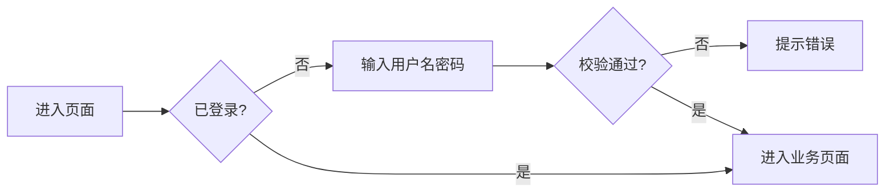

# PRD 文档模版

> 使用说明
> 1. 复制本文件并重命名为 `PRD-<特性名>.md`。
> 2. 每一节都必须填写；不适用时写“不适用”并说明原因，不要直接删除章节。
> 3. 需求条目使用稳定编号（`FR-01`、`NFR-01`），验收标准采用 Given/When/Then，便于后续拆解、开发和测试逐条引用。
> 4. 本模版是“活的文档”：开发或测试中发现范围变化时，必须同步更新版本号和变更记录。

---

## 1. 文档信息

| 字段 | 内容 |
| --- | --- |
| 文档名称 | <!-- 例：问诊用户用户名密码登录 PRD --> |
| 文档版本 | <!-- v1.0 --> |
| 文档状态 | <!-- 草稿 / 评审中 / 已确认 / 已实现 --> |
| 作者 | <!-- 姓名 / AI 协作 --> |
| 创建日期 | <!-- YYYY-MM-DD --> |
| 最后更新 | <!-- YYYY-MM-DD --> |
| 关联需求 | <!-- 原始需求链接或编号 --> |
| 关联文档 | <!-- 设计文档、API 测试文档、测试报告 --> |
| 评审人 | <!-- 产品 / 前端 / 后端 / 测试 --> |

### 1.1 变更记录

| 版本 | 日期 | 变更人 | 变更说明 |
| --- | --- | --- | --- |
| v1.0 | YYYY-MM-DD | | 初稿 |

---

## 2. 背景与目标

### 2.1 背景

<!-- 当前业务/系统现状是什么？存在什么问题？为什么现在要做？ -->

### 2.2 目标

<!-- 用可衡量的方式描述本次要达成的结果，如“用户可使用用户名+密码登录并保持会话”。 -->

### 2.3 成功指标（可选）

| 指标 | 现状 | 目标值 | 统计方式 |
| --- | --- | --- | --- |
| | | | |

---

## 3. 用户与使用场景

### 3.1 目标用户

| 用户角色 | 特征 | 核心诉求 |
| --- | --- | --- |
| | | |

### 3.2 核心场景

<!-- 按“谁 / 在什么情况下 / 做什么 / 期望结果”描述，建议使用 User Story： -->
<!-- 作为 <角色>，我希望 <能力>，以便 <价值>。 -->

1. 作为 ……，我希望 ……，以便 ……。
2. ……

### 3.3 用户流程

<!-- 可粘贴流程图或 Mermaid sequenceDiagram / flowchart。 -->



---

## 4. 范围

### 4.1 本次范围（In Scope）

- <!-- 明确列出本次要交付的能力 -->

### 4.2 不在本次范围（Out of Scope）

- <!-- 明确排除项，避免范围蔓延，例如短信验证码、第三方登录、找回密码 -->

### 4.3 假设与约束

- <!-- 技术栈、已有系统、时间、合规等约束 -->

---

## 5. 术语表

| 术语 | 定义 |
| --- | --- |
| | |

---

## 6. 功能需求

> 每条需求必须可独立验收。优先级：P0（阻塞发布）/ P1（重要）/ P2（可选）。

### FR-01 <需求名称>

- **优先级**：P0
- **描述**：<!-- 用户能做什么，系统如何响应 -->
- **业务规则**：
  - <!-- 校验规则、边界条件、幂等性等 -->
- **验收标准**：
  - **Given** <!-- 前置条件 -->
  - **When** <!-- 操作 -->
  - **Then** <!-- 可观察的结果 -->

### FR-02 <需求名称>

- **优先级**：P1
- **描述**：
- **业务规则**：
- **验收标准**：
  - **Given**
  - **When**
  - **Then**

---

## 7. 非功能需求

| 编号 | 类别 | 要求 | 验收方式 |
| --- | --- | --- | --- |
| NFR-01 | 安全 | <!-- 如密码必须加盐哈希存储，接口不得返回密码 --> | 代码审查 + 接口测试 |
| NFR-02 | 性能 | <!-- 如列表接口 P95 < 300ms --> | 压测 / 日志 |
| NFR-03 | 可用性 | <!-- 如错误提示可理解，表单有加载态 --> | 手工验收 |
| NFR-04 | 兼容性 | <!-- 浏览器、分辨率 --> | 手工验收 |
| NFR-05 | 可观测性 | <!-- 日志、健康检查 --> | 检查 actuator |

---

## 8. 交互与界面说明

### 8.1 页面/组件清单

| 页面/组件 | 路径 | 说明 |
| --- | --- | --- |
| | | |

### 8.2 交互细节

- 字段校验：<!-- 必填、长度、格式、错误文案 -->
- 加载态：<!-- 按钮 loading、骨架屏 -->
- 错误态：<!-- 网络错误、业务错误 -->
- 空状态：<!-- 无数据时展示 -->
- 成功反馈：<!-- toast / 跳转 -->

### 8.3 文案

| 场景 | 中文文案 | 英文文案（如涉及 i18n） |
| --- | --- | --- |
| | | |

---

## 9. 数据与接口契约

### 9.1 数据模型

| 表/实体 | 字段 | 类型 | 约束 | 说明 |
| --- | --- | --- | --- | --- |
| | | | | |

### 9.2 接口列表

| 编号 | 方法 | 路径 | 鉴权 | 说明 |
| --- | --- | --- | --- | --- |
| API-01 | POST | /api/... | 无 | |

### 9.3 接口详情

#### API-01 <名称>

- **请求**：
  ```http
  POST /api/... HTTP/1.1
  Content-Type: application/json

  {
    "field": "value"
  }
  ```
- **成功响应**（HTTP 200）：
  ```json
  { "code": 0, "message": "success", "data": {} }
  ```
- **失败响应**：

  | HTTP | code | 场景 |
  | --- | --- | --- |
  | 400 | 40001 | 参数校验失败 |
  | 401 | 40101 | 未认证/凭证错误 |
  | 409 | 40901 | 唯一性冲突 |

---

## 10. 拆分步骤（Implementation Plan）

> 将特性拆成可独立提交、可独立验证的增量，每步都要说明“交付物”和“验证方式”。

| 步骤 | 内容 | 交付物 | 验证方式 | 依赖 |
| --- | --- | --- | --- | --- |
| SP-1 | <!-- 数据库/实体 --> | | | |
| SP-2 | <!-- 后端接口 --> | | | |
| SP-3 | <!-- 前端页面 --> | | | |
| SP-4 | <!-- 联调 --> | | | |
| SP-5 | <!-- 测试与文档 --> | | | |

---

## 11. 风险与依赖

| 风险/依赖 | 影响 | 概率 | 应对措施 | 负责人 |
| --- | --- | --- | --- | --- |
| | | | | |

---

## 12. 测试要点

- **功能测试**：<!-- 正向、反向、边界 -->
- **安全测试**：<!-- 越权、注入、敏感信息泄露 -->
- **兼容性测试**：<!-- 浏览器/分辨率 -->
- **回归范围**：<!-- 受影响的其他功能 -->

验收通过标准：所有 P0/P1 需求验收标准通过，接口测试全部通过，无 P0/P1 缺陷。

---

## 13. 发布与回滚

- **发布步骤**：
- **配置变更**：
- **回滚方案**：
- **数据迁移**：

---

## 14. 附录

- 原型/设计稿：
- 相关截图：
- 参考资料：
